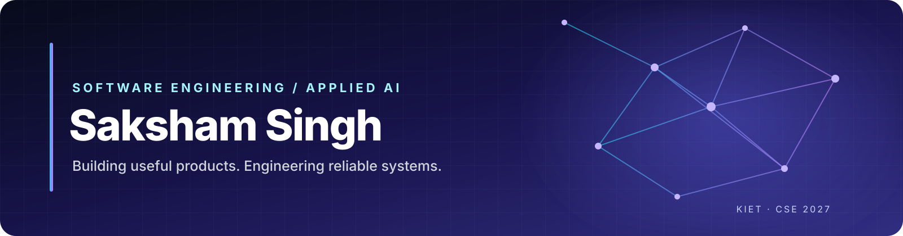

### Building useful software at the intersection of engineering and AI.

[Portfolio](https://saksham-singh.in) · [LinkedIn](https://linkedin.com/in/saksham-singh-5b2627290) · [LeetCode](https://leetcode.com/sakshambyte) · [Email](mailto:saksham22.dev@gmail.com)

---

## About

I'm **Saksham Singh**, a Computer Science & Engineering undergraduate at **KIET Group of Institutions (2023–2027)**. I build practical software across applied AI, backend development, computer vision, and full-stack applications.

My current focus is on writing maintainable software, strengthening engineering fundamentals, and building AI applications whose behavior and limitations are clearly documented.

- **Engineering interests:** Backend systems, APIs, full-stack products, and developer tools.
- **Applied AI:** LLM applications, RAG, multi-agent workflows, and computer vision.
- **Problem solving:** Data structures and algorithms using C++ and Python.
- **Looking for:** Entry-level software engineering and applied AI opportunities.

## Featured projects

These are selected projects, not a complete list of repositories. Project status, implementation details, and limitations are documented in each repository.

| Project | What it demonstrates | Stack |
| --- | --- | --- |
| [Quorum — Multi-Agent Research Assistant](https://github.com/sakshamsingh22/quorum-multi-agent-research) | Four-stage research workflow for web discovery, source reading, report synthesis, and critique. | Python, LangChain, Mistral, Tavily, Streamlit |
| [AI Video Assistant](https://github.com/sakshamsingh22/AI-Video-Assistant) | Media transcription, summaries, action-item extraction, and transcript-grounded Q&A. | Python, Whisper, Sarvam AI, ChromaDB, Mistral |
| [Indian Sign Language Detection](https://github.com/sakshamsingh22/Sign-Language-Detection) | Webcam-based gesture recognition with hand tracking, classification, and speech feedback. | Python, OpenCV, MediaPipe, TensorFlow, MobileNetV2 |
| [SamTrack OS](https://github.com/sakshamsingh22/SamTrack-OS) | Productivity and coding-tracker application focused on DSA progress and focus management. | JavaScript |
| [3D Portfolio](https://github.com/sakshamsingh22/portfolio-website) | Interactive personal portfolio with 3D scenes and motion. | React, Vite, Three.js, React Three Fiber |
| [WIBLY](https://github.com/sakshamsingh22/wibly) | Small-business web design and development studio project. | React, Vite, Node.js, Express |

---

## GitHub analytics

 

## Contribution activity

## Achievements

> **About these cards:** Statistics and activity visualizations are fetched from public GitHub profile data by community-maintained services. They may be cached, delayed, or temporarily unavailable. GitHub's native contribution calendar remains visible on the profile page as well.

## Technical toolkit

**Languages:** Python, C++, JavaScript, SQL, HTML, CSS  
**Frontend:** React, Vite, Tailwind CSS  
**Backend:** FastAPI, Node.js, Express, REST APIs  
**Applied AI / ML:** LangChain, RAG, Streamlit, OpenCV, MediaPipe, TensorFlow, Whisper  
**Databases & tools:** MySQL, SQLite, ChromaDB, Git, GitHub, Docker

I keep this list focused on technologies I have used in projects or practical learning. Individual repositories contain the exact dependencies and implementation details.

## Problem solving

- [LeetCode](https://leetcode.com/sakshambyte)
- [GeeksforGeeks](https://auth.geeksforgeeks.org/user/sakshambyte)

## Engineering approach

- **Make it understandable:** document setup, architecture, configuration, and trade-offs.
- **Validate claims:** distinguish measured results from experiments and assumptions.
- **Test important behavior:** cover edge cases and make failures visible.
- **Build responsibly:** protect credentials, validate untrusted input, and document limitations.

## Current focus

- Strengthening DSA, SQL, DBMS, operating systems, and computer networks.
- Improving backend engineering and API design.
- Building reliable AI applications with meaningful evaluation and reproducible workflows.

---

**Interested in building useful software and practical AI systems.**

[Portfolio](https://saksham-singh.in) · [LinkedIn](https://linkedin.com/in/saksham-singh-5b2627290) · [GitHub](https://github.com/sakshamsingh22)

